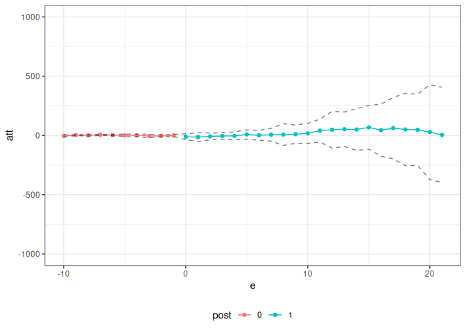
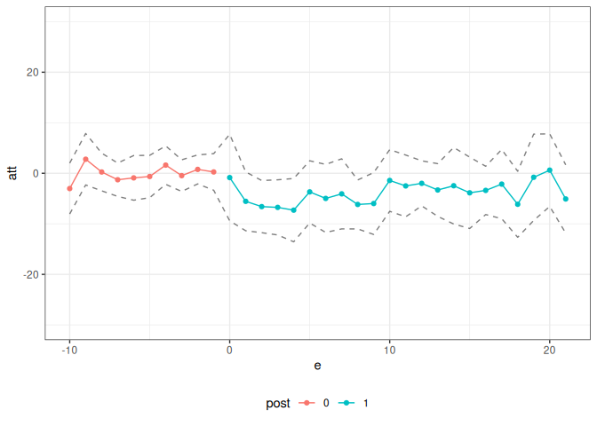

<!-- README.md is generated from README.Rmd. Please edit that file -->

# Pandemic Policy Evaluation (ppe) package

> **Note:** This package is only lightly maintained. Most of the general
> functionality it provides — including empirical bootstrap inference
> and aggregation of group-time average treatment effects — is now
> available through the `pte_default` method in the
> [`ptetools`](https://bcallaway11.github.io/ptetools/) package
> ([GitHub](https://github.com/bcallaway11/ptetools)). The main reason
> to use `ppe` directly is for the pandemic-specific application and
> estimators described below.

The `ppe` package contains code for estimating policy effects during the
pandemic. It is the companion code for [Callaway and Li (2023), Policy
Evaluation during a Pandemic](https://arxiv.org/abs/2105.06927). The
central idea of that paper is to compare locations who implemented some
Covid-19 related policy to other locations that did not implement the
policy *and that had the same pre-treatment values of Covid-19 related
characteristics*. These characteristics definitely include (i) the
current number of cases and (ii) the number of susceptible individuals
(or equivalently the cumulative number of cases). They might also
include demographic characteristics, population densities, region of the
country, among others.

This amounts to an unconfoundedness-type strategy. In the paper, we
compare it to a difference in differences strategy and argue that the
unconfoundedness strategy is likely to be more appropriate to evaluate
policies during the pandemic. The rationale for this argument is that
epidemic models from the epidemiology literature are highly nonlinear
but do not involve individual-level unobserved heterogeneity. See our
[five minute
summary](https://bcallaway11.github.io/posts/five-minute-pandemic-policy)
for additional discussion along these lines.

In practice, we use a doubly robust estimation procedure that estimates
both the propensity score (which is related to the treatment assigment
model) and an outcome regression for untreated potential outcomes (which
is related to the epidemic model). An important advantage of this is
that, at least to some extent, it allows us to side-step the issue of
estimating a full epidemic model.

To demonstrate our approach, we provide a shortened version of the
application from our paper which is about the effect of shelter-in-place
orders early in the pandemic. We have state-level data about Covid-19
cases, tests, and the timing when a state adopted a shelter-in-place
order.

``` r
# load the data
data(covid_data)

# formula for covariates
xformla <- ~ current + I(current^2) + region + totalTestResults
```

A first issue is that there are major overlap violations — for example,
there are just not good comparison states for New York. As a first step,
we drop those:

``` r
trim_id_list <- lapply(c(10,15,20,25,30),
                       did::trimmer,
                       tname="time.period",
                       idname="state_id",
                       gname="group",
                       xformla=xformla,
                       data=covid_data,
                       control_group="nevertreated",
                       threshold=0.95)
time_id_list <- unlist(trim_id_list)
```

``` r
# states that we will drop
unique(subset(covid_data, state_id %in% time_id_list)$state)
#>  [1] "AL" "CA" "CO" "CT" "FL" "GA" "IL" "LA" "ME" "MI" "MO" "MS" "NH" "NJ" "NY"
#> [16] "PA" "RI" "SC" "TX" "VT" "WA"
covid_data2 <- subset(covid_data, !(state_id %in% time_id_list))
```

Next, we use the [`pte`](https://github.com/bcallaway11/pte) package to
estimate policy effects. This basically involves us only having to write
a new function to compute group-time average treatment effects — for us,
it is the function
[`covid_attgt`](https://github.com/bcallaway11/ppe/blob/master/R/covid_attgt.R)
(which is essentially just a function to compute doubly robust treatment
effect estimates under unconfoundedness and that include lags of some
variables).

``` r
res <- pte(yname="positive",
           gname="group",
           tname="time.period",
           idname="state_id",
           data=covid_data2,
           subset_fun=two_by_two_subset,
           setup_pte_fun=setup_pte_basic,
           attgt_fun=covid_attgt,
           xformla=xformla,
           max_e=21,
           min_e=-10) 
#> Warning in pte(yname = "positive", gname = "group", tname = "time.period", : 'pte' is deprecated.
#> Use 'pte2' instead.
#> See help("Deprecated")
#> Warning in BMisc::getListElement(selective.se.inner, "se"): 'BMisc::getListElement' is deprecated.
#> Use 'get_list_element' instead.
#> See help("Deprecated")
#> Warning in BMisc::getListElement(selective.se.inner, "inf.func"): 'BMisc::getListElement' is deprecated.
#> Use 'get_list_element' instead.
#> See help("Deprecated")
#> Warning in BMisc::getListElement(dynamic.se.inner, "se"): 'BMisc::getListElement' is deprecated.
#> Use 'get_list_element' instead.
#> See help("Deprecated")
#> Warning in BMisc::getListElement(dynamic.se.inner, "inf.func"): 'BMisc::getListElement' is deprecated.
#> Use 'get_list_element' instead.
#> See help("Deprecated")

summary(res)
#> 
#> Overall ATT:  
#>      ATT    Std. Error     [ 95%  Conf. Int.] 
#>  14.8882       79.4475  -140.8261    170.6024 
#> 
#> 
#> Dynamic Effects:
#>  Event Time Estimate Std. Error     [95%  Conf. Band] 
#>         -10  -3.7266     3.5727  -12.8078      5.3545 
#>          -9   2.6607     1.5442   -1.2643      6.5857 
#>          -8   0.8290     2.5877   -5.7485      7.4065 
#>          -7   5.2843     2.3458   -0.6782     11.2469 
#>          -6   2.8555     1.9498   -2.1005      7.8115 
#>          -5   1.3589     4.6737  -10.5208     13.2386 
#>          -4   0.3294     4.0833  -10.0496     10.7083 
#>          -3  -4.2227     5.2468  -17.5591      9.1137 
#>          -2  -3.8447     2.4588  -10.0945      2.4050 
#>          -1  -0.2234     3.5167   -9.1621      8.7154 
#>           0 -10.8156    10.8095  -38.2912     16.6600 
#>           1 -13.7998    14.5778  -50.8536     23.2540 
#>           2  -7.8432    11.0886  -36.0281     20.3417 
#>           3  -4.5541    11.9893  -35.0284     25.9201 
#>           4  -3.5368    11.8730  -33.7156     26.6419 
#>           5   8.5221    12.9938  -24.5055     41.5497 
#>           6   1.1140    13.6408  -33.5583     35.7863 
#>           7   6.6384    21.0232  -46.7984     60.0753 
#>           8   7.1288    34.7259  -81.1374     95.3950 
#>           9  10.8758    29.5162  -64.1483     85.8999 
#>          10  17.5057    32.9132  -66.1531    101.1645 
#>          11  40.8318    42.1074  -66.1966    147.8602 
#>          12  48.6134    56.4684  -94.9179    192.1447 
#>          13  52.4228    67.6682 -119.5761    224.4217 
#>          14  50.2000    42.6587  -58.2296    158.6297 
#>          15  68.2960    86.8683 -152.5056    289.0976 
#>          16  44.7305    77.7393 -152.8670    242.3280 
#>          17  61.4670    77.5732 -135.7085    258.6424 
#>          18  50.4635   116.4089 -245.4243    346.3513 
#>          19  47.3392   110.6619 -233.9410    328.6194 
#>          20  28.6326   137.6517 -321.2501    378.5153 
#>          21   4.3445   146.0782 -366.9567    375.6457 
#> ---
#> Signif. codes: `*' confidence band does not cover 0
```

and we can also plot the results in event study.

``` r
ggpte(res) + ylim(c(-1000,1000))
```

<!-- -->

To conclude, we provide estimated effects of the effects of
shelter-in-place orders on travel. In the paper, we mainly consider the
case where (i) the policy can have a direct effect on travel, (ii) the
policy can have a direct effect on Covid-19 cases, and (iii) Covid-19
cases can have their own effect on travel. This means that the policy
can have an indirect effect on travel through its effect on Covid-19
cases. We show in the paper that neither standard DID (ignoring cases)
nor DID that includes current cases as a covariate delivers a suitable
estimate of the effect of the policy on travel in this case. We propose
an alternative estimator that accounts for the indirect effect of the
policy on travel through its effect on cases, and show code for this
approach below.

``` r
oo_res <- pte(yname="retail_and_recreation_percent_change_from_baseline",
           gname="group",
           tname="time.period",
           idname="state_id",
           data=covid_data2,
           subset_fun=two_by_two_subset,
           setup_pte_fun=setup_pte_basic,
           attgt_fun=other_outcome_attgt,
           xformla=xformla,
           max_e=21,
           min_e=-10,
           Iname="current",
           adjustI=TRUE) 
#> Warning in pte(yname = "retail_and_recreation_percent_change_from_baseline", : 'pte' is deprecated.
#> Use 'pte2' instead.
#> See help("Deprecated")
#> Warning in BMisc::getListElement(selective.se.inner, "se"): 'BMisc::getListElement' is deprecated.
#> Use 'get_list_element' instead.
#> See help("Deprecated")
#> Warning in BMisc::getListElement(selective.se.inner, "inf.func"): 'BMisc::getListElement' is deprecated.
#> Use 'get_list_element' instead.
#> See help("Deprecated")
#> Warning in BMisc::getListElement(dynamic.se.inner, "se"): 'BMisc::getListElement' is deprecated.
#> Use 'get_list_element' instead.
#> See help("Deprecated")
#> Warning in BMisc::getListElement(dynamic.se.inner, "inf.func"): 'BMisc::getListElement' is deprecated.
#> Use 'get_list_element' instead.
#> See help("Deprecated")

summary(oo_res)
#> 
#> Overall ATT:  
#>      ATT    Std. Error     [ 95%  Conf. Int.]  
#>  -3.9162        1.9043    -7.6485      -0.184 *
#> 
#> 
#> Dynamic Effects:
#>  Event Time Estimate Std. Error    [95%  Conf. Band]  
#>         -10  -3.0210     2.4073 -10.3959      4.3539  
#>          -9   2.7846     1.3531  -1.3606      6.9299  
#>          -8   0.2543     1.4666  -4.2388      4.7475  
#>          -7  -1.2765     0.9152  -4.0804      1.5273  
#>          -6  -0.9085     1.2627  -4.7767      2.9597  
#>          -5  -0.6359     1.4899  -5.2004      3.9286  
#>          -4   1.6184     1.1964  -2.0468      5.2837  
#>          -3  -0.4660     1.0718  -3.7496      2.8176  
#>          -2   0.7693     0.7319  -1.4730      3.0117  
#>          -1   0.2643     1.1686  -3.3160      3.8445  
#>           0  -0.8510     2.1805  -7.5311      5.8290  
#>           1  -5.5461     2.0183 -11.7292      0.6370  
#>           2  -6.5928     1.6265 -11.5758     -1.6099 *
#>           3  -6.7447     1.7367 -12.0652     -1.4243 *
#>           4  -7.2925     1.8923 -13.0897     -1.4954 *
#>           5  -3.6784     2.2736 -10.6439      3.2871  
#>           6  -4.9731     2.0578 -11.2773      1.3311  
#>           7  -4.0683     2.2042 -10.8210      2.6844  
#>           8  -6.1649     1.7244 -11.4477     -0.8821 *
#>           9  -5.9830     1.9759 -12.0363      0.0703  
#>          10  -1.4185     2.4645  -8.9687      6.1317  
#>          11  -2.4974     2.2211  -9.3020      4.3072  
#>          12  -1.9884     1.7679  -7.4044      3.4275  
#>          13  -3.3056     2.0270  -9.5155      2.9044  
#>          14  -2.4633     2.3299  -9.6010      4.6744  
#>          15  -3.8627     1.9979  -9.9835      2.2582  
#>          16  -3.3849     1.9396  -9.3270      2.5571  
#>          17  -2.1404     2.2201  -8.9419      4.6612  
#>          18  -6.1309     1.7688 -11.5498     -0.7119 *
#>          19  -0.7883     2.2083  -7.5536      5.9770  
#>          20   0.6190     2.6606  -7.5319      8.7700  
#>          21  -5.0789     2.9730 -14.1870      4.0291  
#> ---
#> Signif. codes: `*' confidence band does not cover 0

# make an event study plot
ggpte(oo_res) + ylim(c(-30,30))
```

<!-- -->
